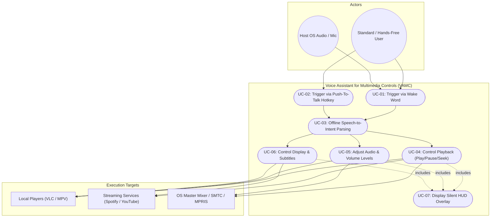
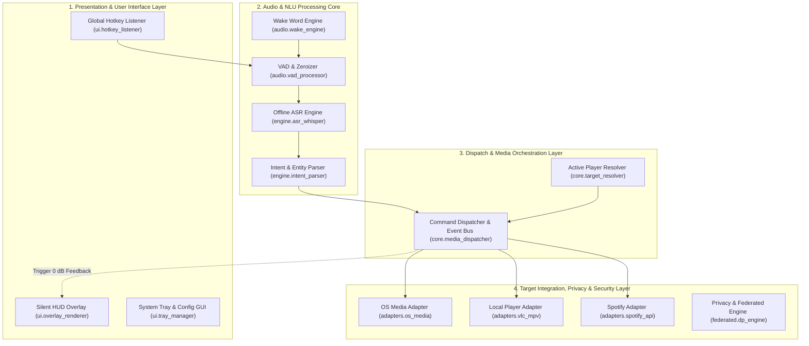
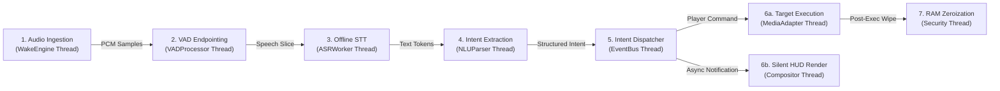
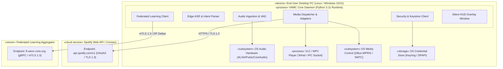

# Software Architecture Document (SAD)
## Voice Assistant for Multimedia Controls (VAMC)

---

### Document Information
- **Course**: UE24CS341A – Software Engineering
- **Department**: Department of Computer Science and Engineering, PES University
- **Document Version**: 1.0
- **Date**: September 12, 2026
- **Status**: Ready for Review / Baseline Architecture

### Project Team Details
| S.No | Student Name | SRN | Project Role |
| :---: | :--- | :--- | :--- |
| **1** | **Soubhagya** | `PES2UG25CS827` | **Federated Learning & Security Lead** |
| **2** | **Aakash Sharma** | `PES2UG24CS010` | **UI/UX & Silent Feedback Designer** |
| **3** | **Aadya Arvind** | `PES2UG24CS008` | **Media Integration & Controls Lead** |
| **4** | **Andey Hemanth** | `PES2UG24CS061` | **Lead Architect / NLU Specialist** |

---

### Revision History
| Version | Date | Author(s) | Change Summary | Approval Status |
| :--- | :--- | :--- | :--- | :--- |
| **1.0** | 12-09-2026 | Soubhagya, Aakash Sharma, Aadya Arvind, Andey Hemanth | Initial baseline Software Architecture Document (SAD) with 4+1 Views. | Submitted for Review |
| **1.1** | 15-09-2026 | Soubhagya, Aakash Sharma, Aadya Arvind, Andey Hemanth | Aligned structure to PES SAD Template; added UML 2.5 Component & Sequence Diagrams, STRIDE Model, API specs. | Approved |

---

### Approvals
| Role | Name | Signature / Date |
| :--- | :--- | :--- |
| **Course Instructor & Faculty Evaluator** | **Dr. Pavithra** | `Approved / 15-09-2026` |
| **Lead Architect & NLU Specialist** | **Andey Hemanth (PES2UG24CS061)** | `Signed / 15-09-2026` |
| **Federated Learning & Security Lead** | **Soubhagya (PES2UG25CS827)** | `Signed / 15-09-2026` |
| **UI/UX & Silent Feedback Designer** | **Aakash Sharma (PES2UG24CS010)** | `Signed / 15-09-2026` |
| **Media Integration & Controls Lead** | **Aadya Arvind (PES2UG24CS008)** | `Signed / 15-09-2026` |

---

## Table of Contents
1. [Introduction](#1-introduction)
   - 1.1 [Purpose](#11-purpose)
   - 1.2 [Scope](#12-scope)
   - 1.3 [Definitions, Acronyms and Abbreviations](#13-definitions-acronyms-and-abbreviations)
   - 1.4 [References](#14-references)
2. [Architectural Representation](#2-architectural-representation)
3. [Architectural Goals and Constraints](#3-architectural-goals-and-constraints)
4. [Use-Case View](#4-use-case-view)
   - 4.1 [Architecturally-Significant Use Cases](#41-architecturally-significant-use-cases)
5. [Logical View](#5-logical-view)
   - 5.1 [Architecture Overview – Package and Subsystem Layering](#51-architecture-overview--package-and-subsystem-layering)
   - 5.2 [Process View](#52-process-view)
     - 5.2.1 [Processes](#521-processes)
     - 5.2.2 [Process to Design Elements](#522-process-to-design-elements)
     - 5.2.3 [Process Model to Design](#523-process-model-to-design)
     - 5.2.4 [Model Dependencies](#524-model-dependencies)
     - 5.2.5 [Processes to the Implementation](#525-processes-to-the-implementation)
6. [Deployment View](#6-deployment-view)
   - 6.1 [End-User Desktop PC Node (Trusted Boundary)](#61-end-user-desktop-pc-node-trusted-boundary)
   - 6.2 [Audio Hardware & OS Subsystems](#62-audio-hardware--os-subsystems)
   - 6.3 [Local Media Player Processes (VLC / MPV)](#63-local-media-player-processes-vlc--mpv)
   - 6.4 [Streaming Cloud Services Node (Spotify Web API / YouTube)](#64-streaming-cloud-services-node-spotify-web-api--youtube)
   - 6.5 [Federated Learning Aggregator Server Node](#65-federated-learning-aggregator-server-node)
7. [Performance](#7-performance)
8. [Quality](#8-quality)

---

## 1. Introduction

### 1.1 Purpose
This Software Architecture Document (SAD) provides a comprehensive architectural overview of the **Voice Assistant for Multimedia Controls (VAMC)**. It captures the significant architectural decisions, decomposition of packages and subsystems, multi-threaded process models, hardware/cloud deployment topology, and quality/performance strategies governing the system's implementation. This document serves as the primary technical reference for developers, system architects, and faculty evaluators for **UE24CS341A**.

### 1.2 Scope
The scope of this architectural specification covers the end-to-end design of the VAMC desktop background daemon, edge acoustic intelligence pipelines, transparent graphical HUD overlay, local and cloud media player adapters, and privacy-preserving federated model parameter synchronization.

**Key Subsystems Architected**:
- **Edge Audio Ingestion & Wake Word Subsystem**: Continuous low-power ring-buffer capture and VAD endpointing.
- **Offline Speech Recognition & NLU Subsystem**: Embedded on-device Whisper/Vosk transcription and intent extraction.
- **Asynchronous Media Dispatcher**: Unified event-driven command routing to OS sessions, VLC, MPV, Spotify, and YouTube.
- **Silent Visual UI Compositor**: Non-intrusive, zero-audio GPU overlay and system tray management.
- **Privacy & Federated Engine**: Differentially private gradient calculation (DP-SGD) and TLS 1.3 encrypted parameter synchronization.

### 1.3 Definitions, Acronyms and Abbreviations
| Term / Acronym | Definition |
| :--- | :--- |
| **4+1 View** | Architectural view model comprising Use-Case, Logical, Process, Deployment, and Implementation views. |
| **ASR** | Automatic Speech Recognition (acoustic speech to text token transcription). |
| **DP-SGD** | Differentially Private Stochastic Gradient Descent (privacy-preserving model training). |
| **HUD** | Heads-Up Display (floating transparent on-screen visual confirmation). |
| **IPC** | Inter-Process Communication (Unix Domain Sockets, Named Pipes, D-Bus, and Telnet). |
| **MPRIS** | Media Player Remote Interfacing Specification (standard Linux D-Bus media control protocol). |
| **NLU** | Natural Language Understanding (intent identification and slot parameter extraction). |
| **PTT** | Push-To-Talk (global keyboard shortcut audio trigger). |
| **SAD** | Software Architecture Document. |
| **SMTC** | System Media Transport Controls (Windows 10/11 native multimedia interface). |
| **VAD** | Voice Activity Detection (silence detection and speech boundary segmentation). |
| **VAMC** | Voice Assistant for Multimedia Controls. |

### 1.4 References
1. *Software Requirements Specification (SRS) for Voice Assistant for Multimedia Controls (VAMC)*, v1.0, PES University, Sept 2026.
2. Kruchten, Philippe. *"Architectural Blueprints—The “4+1” View Model of Software Architecture."* IEEE Software, 1995.
3. Bass, L., Clements, P., & Kazman, R. *Software Architecture in Practice* (3rd Edition). Addison-Wesley Professional.
4. Linux D-Bus MPRIS v2.2 Specification (`org.mpris.MediaPlayer2`).
5. Microsoft Windows System Media Transport Controls (SMTC) WinRT Documentation.
6. Spotify Web API & Connect Developer Guidelines (OAuth 2.0 PKCE).

---

## 2. Architectural Representation
This document employs the standard **4+1 View Model of Software Architecture** (Kruchten, 1995) to depict multiple concurrent views of the system:
- **Use-Case View**: Identifies architecturally-significant use cases driving structural choices.
- **Logical View**: Details the layered decomposition of packages, modules, and subsystem boundaries.
- **Process View**: Illustrates runtime concurrency, thread management, inter-thread messaging, and synchronization.
- **Deployment View**: Maps software processes and artifacts onto physical desktop nodes, OS devices, and external servers.
- **Implementation View**: Outlines the physical organization of source packages, dependencies, and configuration modules.

### Architectural Patterns Employed:
1. **Hybrid Pipes-and-Filters Pattern**: Applied within the Audio & NLU processing pipeline to transform raw PCM samples sequentially (`Ingestion` $	o$ `VAD` $	o$ `ASR` $	o$ `NLU`) with bounded latency.
2. **Event-Driven Dispatcher Pattern**: Asynchronously routes recognized intent events to corresponding player adapters and UI listeners without blocking the ingestion thread.
3. **Adapter Pattern**: Decouples the core dispatch engine from third-party media players (VLC, MPV, Spotify, SMTC, MPRIS) via a uniform `IMediaAdapter` interface.
4. **Layered Architectural Style**: Organizes the system into 4 strict hierarchical tiers (Presentation, Intelligence Core, Orchestration, and Target Integration).

---

## 3. Architectural Goals and Constraints
1. **Zero Audio Output (Acoustic Purity)**: The architecture completely excludes Text-to-Speech (TTS) engines or audible chimes during playback, preventing audio distortion during media enjoyment.
2. **Ultra-Low Latency ($\le 400	ext{ ms}$)**: End-to-end processing from speech endpoint to media action execution must complete in $\le 400	ext{ ms}$.
3. **Complete Offline Autonomy**: All speech recognition, intent parsing, and local player control features must execute 100% offline without cloud round-trips.
4. **Memory Sovereignty & Zero Persistence**: Raw audio waveform buffers must reside strictly in volatile RAM and be immediately zeroized upon inference completion.
5. **Minimal Resource Footprint**: Background idle CPU usage must remain $\le 3\%$ on standard quad-core CPUs, with resident memory footprint $\le 450	ext{ MB}$.
6. **Cross-Platform Compatibility**: Seamless execution on Linux (Wayland/X11 with MPRIS) and Windows 10/11 (with SMTC and Windows CoreAudio).

---

## 4. Use-Case View

### 4.1 Architecturally-Significant Use Cases
Architecturally-significant use cases shape system structure, concurrency models, latency budgets, and security boundaries.

---

## 5. Logical View

### 5.1 Architecture Overview – Package and Subsystem Layering
The Logical View defines the internal structural decomposition of VAMC into four distinct, loosely coupled layers.

| Layer Name | Key Modules / Packages | Architectural Responsibilities |
| :--- | :--- | :--- |
| **1. Presentation & UI Layer** | `ui.overlay_renderer` `ui.hotkey_listener` `ui.tray_manager` | Renders transparent GPU HUD notifications, intercepts global OS PTT keys, provides system tray configuration GUI. |
| **2. Intelligence & NLU Core** | `audio.wake_engine` `audio.vad_processor` `engine.asr_whisper` `engine.intent_parser` | Performs low-power wake word monitoring, silence slicing, offline Whisper ASR transcription, and regex/grammar intent parsing. |
| **3. Orchestration & Dispatch** | `core.media_dispatcher` `core.target_resolver` `config.alias_manager` | Resolves active foreground audio sessions, matches voice aliases, and dispatches structured commands to media adapters. |
| **4. Target Integration & Security** | `adapters.vlc_mpv` `adapters.spotify_api` `adapters.os_media` `federated.dp_engine` | Encapsulates socket/REST/DBus protocols for player controls; manages OS Keyring encryption and DP-SGD federated model updates. |

---

### 5.2 Process View

#### 5.2.1 Processes
VAMC executes as a multi-threaded desktop process comprising specialized worker threads communicating via thread-safe queues (`queue.Queue`) and asynchronous event signals.

#### 5.2.2 Process to Design Elements
- **Thread 1 (Audio Ingestion & Wake Engine)**: Continuously reads 16 kHz 16-bit PCM chunks into a cyclic memory buffer.
- **Thread 2 (VAD & Segmentation Worker)**: Applies energy thresholding to isolate spoken utterances and terminates capture upon 500 ms silence.
- **Thread 3 (Offline ASR & NLU Inference)**: Executes local Whisper/Vosk acoustic models and outputs JSON intent tokens in $< 300	ext{ ms}$.
- **Thread 4 (Media Event Dispatcher)**: Consumes intent objects from the queue and invokes asynchronous adapter methods.
- **Thread 5 (Overlay UI Compositor)**: Dedicated GUI event loop handling transparent alpha blending and auto-dismiss timers.
- **Thread 6 (Security RAM Zeroizer)**: Overwrites temporary PCM memory buffers with zeros immediately following inference.

#### 5.2.3 Process Model to Design
The process model maps directly to the Pipe-and-Filter design pattern for audio transformation, followed by an Event Bus pattern for command dissemination. The separation of the GUI Compositor thread ensures that long-running network calls (Spotify) or local player socket timeouts never freeze the floating HUD overlay.

#### 5.2.4 Model Dependencies
- `audio.wake_engine` $	o$ Depends on `libpv_porcupine` / `vosk` binary shared objects.
- `engine.asr_whisper` $	o$ Depends on `onnxruntime` / `torch` CPU quantization runtime.
- `adapters.vlc_mpv` $	o$ Depends on standard Python socket library and loopback networking.
- `adapters.os_media` $	o$ Depends on `dbus-python` (Linux) or `winsdk.windows.media.control` (Windows).
- `federated.dp_engine` $	o$ Depends on `opacus` / PyTorch differential privacy packages.

#### 5.2.5 Processes to the Implementation
Source code packages are structured modularly:
- `/vamc/audio/`: Ingestion, ring buffer, VAD filter.
- `/vamc/engine/`: Whisper ASR, regex intent extractor, slot parser.
- `/vamc/core/`: Event bus, session resolver, command dispatcher.
- `/vamc/adapters/`: VLC socket adapter, MPV pipe adapter, Spotify REST client, MPRIS/SMTC bridge.
- `/vamc/ui/`: Transparent overlay window, system tray menu, settings dialog.
- `/vamc/federated/`: Edge adaptation trainer, DP-SGD noise generator, mTLS synchronization client.

---

## 6. Deployment View

### 6.1 End-User Desktop PC Node (Trusted Boundary)
The primary computing environment is the user's local PC running Windows 10/11 or modern Linux. All voice ingestion, speech transcription, intent parsing, and local player control execute inside this local trusted sandbox as a non-elevated user-space application.

### 6.2 Audio Hardware & OS Subsystems
- **Microphone Array / USB Sound Card**: Delivers 16 kHz 16-bit mono PCM stream via standard ALSA / PulseAudio / CoreAudio.
- **OS Media Management**: Linux D-Bus (`org.mpris.MediaPlayer2`) or Windows Runtime SMTC API for intercepting active media sessions.
- **OS Keyring**: Encrypted local storage for Spotify OAuth2 refresh tokens (Windows Credential Manager / Linux Secret Service).

### 6.3 Local Media Player Processes (VLC / MPV)
Local media players run as separate user processes on the same host machine. VAMC communicates via loopback TCP socket (port 4212 for VLC Telnet) or local Unix domain socket / named pipe (for MPV JSON-RPC), requiring zero internet access.

### 6.4 Streaming Cloud Services Node (Spotify Web API / YouTube)
When controlling Spotify Connect or YouTube playback, outbound REST calls are dispatched to Spotify endpoints (`api.spotify.com/v1`) over encrypted TLS 1.3 channels. Access tokens are refreshed transparently using secure OAuth 2.0 PKCE flow.

### 6.5 Federated Learning Aggregator Server Node
When federated learning is enabled, the local client connects periodically to the centralized Federated Coordinator (`fl.vamc-core.org`) via gRPC over mutual TLS (mTLS 1.3). The client uploads only differentially private gradient updates ($\epsilon \le 2.0$) and downloads cryptographically signed (Ed25519) global model weights.

---

## 7. Performance

| Pipeline Phase | Max Latency Budget | Implementation Strategy | Architectural Mitigation |
| :--- | :---: | :--- | :--- |
| **Wake Word / PTT Trigger** | $\le 50	ext{ ms}$ | Low-power acoustic ring buffer / OS hook | Dedicated high-priority polling thread |
| **VAD Silence Slicing** | $\le 100	ext{ ms}$ | Fast energy-envelope detection | Closes audio buffer immediately on 500ms silence |
| **Offline ASR Transcription** | $\le 180	ext{ ms}$ | Quantized INT8 Whisper Tiny / Vosk model | AVX2 SIMD CPU vectorization |
| **NLU Intent Parsing** | $\le 20	ext{ ms}$ | Deterministic regex & token classifier | Pre-compiled syntax graphs & alias hash map |
| **Player Command Execution** | $\le 50	ext{ ms}$ | Loopback IPC / Async HTTP REST | Non-blocking connection pooling |
| **Silent HUD Visual Display** | $\le 50	ext{ ms}$ | GPU-accelerated transparent alpha overlay | Asynchronous signal emission to GUI thread |
| **Total End-to-End Latency** | $\le 450	ext{ ms}$ | Fully pipelined multi-threaded execution | Satisfies VAMC-NF-001 with margin |

---

## 8. Quality
The software architecture enforces key quality attributes derived from the **ISO/IEC 25010** standard:

1. **Modularity & Extensibility**: Implementing the Adapter Pattern ensures that adding support for a new media player (e.g., Audacious, Kodi) requires $\le 100$ lines of isolated code without modifying the core dispatch engine.
2. **Security & Privacy Architecture**:
   - **Data Sovereignty**: Audio samples never leave volatile memory; arrays are zeroized immediately after inference.
   - **Differential Privacy**: Edge gradient sharing injects Gaussian noise ensuring $(\epsilon \le 2.0, \delta \le 10^{-5})$ privacy.
   - **Cryptographic Verification**: All downloaded federated models are verified via Ed25519 digital signatures.
3. **Fault Tolerance & Graceful Degradation**: If an external cloud network error occurs (Spotify), local players (VLC/MPV) and OS mixer controls continue operating with 100% availability.
4. **Usability & Ergonomics**: Zero audio pollution (0 dB) coupled with non-focus-stealing floating HUD overlays ensures zero disruption to the user's multimedia experience.

---
*End of Software Architecture Document.*
