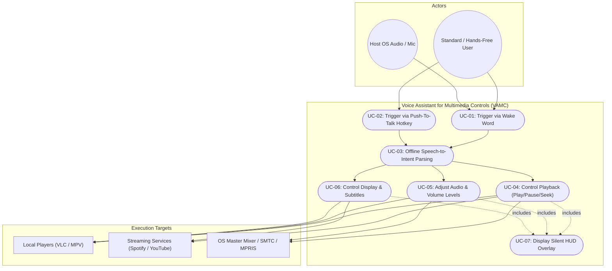
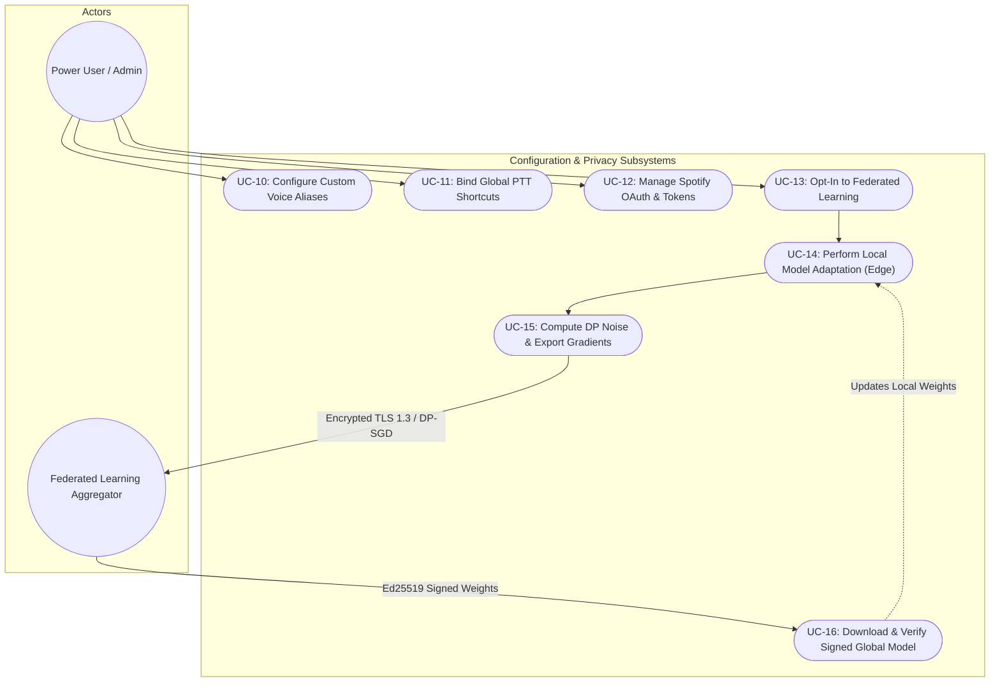

# Software Requirements Specification (SRS)
## Voice Assistant for Multimedia Controls (VAMC)

---

### Document Information
- **Course**: UE24CS341A – Software Engineering
- **Department**: Department of Computer Science and Engineering, PES University
- **Document Version**: 1.0
- **Date**: September 9, 2026
- **Status**: Ready for Review / Baseline

### Team Information
| S.No | Student Name | SRN / Roll Number | Project Role |
| :--- | :--- | :--- | :--- |
| 1 | **Soubhagya** | `PES2UG25CS827` | Federated Learning & Security Lead |
| 2 | **Aakash Sharma** | `PES2UG24CS010` | UI/UX & Silent Feedback Designer |
| 3 | **Aadya Arvind** | `PES2UG24CS008` | Media Integration & Controls Lead |
| 4 | **Andey Hemanth** | `PES2UG24CS061` | Lead Architect / NLU Specialist |

---

### Revision History
| Version | Date | Author(s) | Change Summary | Approval Status |
| :--- | :--- | :--- | :--- | :--- |
| **1.0** | 09-09-2026 | Soubhagya, Aakash Sharma, Aadya Arvind, Andey Hemanth | Initial baseline SRS creation with complete FRs, NFRs, Security Requirements, UML Use Case models, and Traceability Matrix. | Submitted for Review |

### Approvals
| Role | Name | Signature / Verification | Date |
| :--- | :--- | :--- | :--- |
| **Course Coordinator** | Faculty Reviewer | Pending Review | 09-09-2026 |
| **Project Mentor** | Lab Instructor | Pending Review | 09-09-2026 |

---

## Table of Contents
1. [Introduction](#1-introduction)
   - 1.1 [Purpose](#11-purpose)
   - 1.2 [Scope](#12-scope)
   - 1.3 [Audience](#13-audience)
   - 1.4 [Definitions, Acronyms, and Abbreviations](#14-definitions-acronyms-and-abbreviations)
2. [Overall Description](#2-overall-description)
   - 2.1 [Product Perspective](#21-product-perspective)
   - 2.2 [Major Product Functions](#22-major-product-functions)
   - 2.3 [User Roles and Characteristics](#23-user-roles-and-characteristics)
   - 2.4 [Operating Environment](#24-operating-environment)
   - 2.5 [Design and Implementation Constraints](#25-design-and-implementation-constraints)
3. [External Interface Requirements](#3-external-interface-requirements)
   - 3.1 [User Interfaces](#31-user-interfaces)
   - 3.2 [Hardware Interfaces](#32-hardware-interfaces)
   - 3.3 [Software Interfaces](#33-software-interfaces)
   - 3.4 [Communications Protocols](#34-communications-protocols)
4. [System Features (Detailed Functional Requirements)](#4-system-features-detailed-functional-requirements)
   - 4.1 [Voice Activation & Audio Ingestion](#41-voice-activation--audio-ingestion)
   - 4.2 [Offline Speech Recognition & Intent Parsing](#42-offline-speech-recognition--intent-parsing)
   - 4.3 [Core Playback & Navigation Controls](#43-core-playback--navigation-controls)
   - 4.4 [Volume & Audio Management](#44-volume--audio-management)
   - 4.5 [Streaming & Local Media Player Integrations](#45-streaming--local-media-player-integrations)
   - 4.6 [Display, Subtitle & Playback Rate Controls](#46-display-subtitle--playback-rate-controls)
   - 4.7 [Silent Visual Notification & HUD Overlay](#47-silent-visual-notification--hud-overlay)
   - 4.8 [Privacy-Preserving Federated Model Synchronization](#48-privacy-preserving-federated-model-synchronization)
5. [Non-Functional Requirements (Detailed)](#5-non-functional-requirements-detailed)
   - 5.1 [Performance & Latency](#51-performance--latency)
   - 5.2 [Reliability & Availability](#52-reliability--availability)
   - 5.3 [Resource Utilization](#53-resource-utilization)
   - 5.4 [Usability & Non-Intrusiveness](#54-usability--non-intrusiveness)
   - 5.5 [Portability & Compatibility](#55-portability--compatibility)
   - 5.6 [Security & Privacy](#56-security--privacy)
     - 5.6.1 [Security Objectives](#561-security-objectives)
     - 5.6.2 [Security Requirements](#562-security-requirements)
6. [Quality Attributes & Acceptance Tests](#6-quality-attributes--acceptance-tests)
   - 6.1 [Exit Criteria for Acceptance](#61-exit-criteria-for-acceptance)
   - 6.2 [Acceptance Test Suites](#62-acceptance-test-suites)
7. [System Models and Diagrams](#7-system-models-and-diagrams)
   - 7.1 [UML Use Case Diagram 1: Voice-Driven Multimedia Control & Feedback](#71-uml-use-case-diagram-1-voice-driven-multimedia-control--feedback)
   - 7.2 [UML Use Case Diagram 2: System Configuration & Federated Learning Lifecycle](#72-uml-use-case-diagram-2-system-configuration--federated-learning-lifecycle)
8. [Requirements Traceability Matrix (RTM)](#8-requirements-traceability-matrix-rtm)

---

## 1. Introduction

### 1.1 Purpose
The purpose of this document is to provide a comprehensive **Software Requirements Specification (SRS)** for the **Voice Assistant for Multimedia Controls (VAMC)**. This document specifies the functional requirements, non-functional constraints, external interface behaviors, system models, security criteria, and acceptance test boundaries for the system. It serves as the primary formal contract between students, project evaluators, and system architects.

### 1.2 Scope
The **Voice Assistant for Multimedia Controls (VAMC)** is an intelligent, privacy-first desktop background service and overlay assistant engineered to deliver touchless control over multimedia playback across multiple environments:
- **Operating System Media**: Global system master volume, mute, and native OS media session keys (Windows SMTC, Linux MPRIS/DBus, macOS MediaRemote).
- **Local Desktop Media Players**: Desktop players including VLC Media Player and MPV via IPC/Telnet APIs.
- **Online & Streaming Platforms**: Streaming services including Spotify (via Spotify Connect / Web API) and YouTube (via browser extension bridge / active window automation).

**Core Capabilities Included**:
1. **Dual Activation Modes**: Always-listening offline wake word detection (e.g., *"Hey Assistant"*) alongside configurable push-to-talk keyboard hotkeys.
2. **Edge Speech Processing**: Fully offline automatic speech recognition (ASR) and natural language intent understanding (NLU).
3. **Silent Visual Feedback**: Completely silent user interface notifications (translucent floating HUD and system tray toasts) ensuring media listening is never interrupted by noisy Text-to-Speech (TTS) voice replies.
4. **Privacy-Preserving Federated Learning**: Optional edge-based local model tuning for customized voice commands, with model weight aggregation over secure channels without transmitting raw audio recordings.

**Exclusions**:
- Voice-based financial or e-commerce purchases.
- Standalone hardware device manufacturing (runs as software on standard consumer PCs).
- Live audio re-streaming or illegal media ripping.

### 1.3 Audience
This specification is intended for:
- **Development Team**: To guide software architecture, audio pipeline implementation, media player integrations, and UI development.
- **QA & Testing Engineers**: To construct automated verification scripts, acceptance test suites, and validate the Requirements Traceability Matrix.
- **Project Mentors & Course Instructors**: To evaluate compliance with Software Engineering standards (UE24CS341A).

### 1.4 Definitions, Acronyms, and Abbreviations
| Term / Acronym | Definition |
| :--- | :--- |
| **ASR** | Automatic Speech Recognition (converting speech audio to text). |
| **DP-SGD** | Differentially Private Stochastic Gradient Descent (privacy-preserving model training). |
| **FL** | Federated Learning (decentralized machine learning without raw data sharing). |
| **HUD** | Heads-Up Display (non-intrusive on-screen visual overlay). |
| **IPC** | Inter-Process Communication (DBus, Named Pipes, WebSockets, or Unix Sockets). |
| **MPRIS** | Media Player Remote Interfacing Specification (Linux standard for media controls). |
| **NLU** | Natural Language Understanding (extracting intent and entity parameters from text). |
| **OS** | Operating System. |
| **PTT** | Push-To-Talk (activation via dedicated physical key or hotkey combination). |
| **RTM** | Requirements Traceability Matrix. |
| **SMTC** | System Media Transport Controls (Windows native multimedia API). |
| **SRS** | Software Requirements Specification. |
| **STT** | Speech-To-Text. |
| **TLS** | Transport Layer Security (cryptographic network security protocol). |
| **VAMC** | Voice Assistant for Multimedia Controls. |
| **VLC** | VideoLAN Client media player. |
| **VAD** | Voice Activity Detection (detecting presence of human speech in audio stream). |

---

## 2. Overall Description

### 2.1 Product Perspective
VAMC operates as a lightweight, low-footprint desktop daemon sitting between the host audio hardware, user input subsystems, and local/remote media execution targets.

```
                                  +---------------------------------------+
                                  |         Host Operating System         |
                                  |   (Windows / Linux / macOS Audio)     |
                                  +-------------------+-------------------+
                                                      |
                                                      v
+------------------+   Wake Word / PTT    +-----------------------+
| User Microphone  | -------------------> | VAMC Daemon Core      |
+------------------+                      | - Porcupine / Vosk    |
                                          | - Whisper Tiny/Base   |
+------------------+   Hotkey Trigger     | - Regex / Rule NLU    |
| Keyboard / Mouse | -------------------> | - Intent Dispatcher   |
+------------------+                      +-----------+-----------+
                                                      |
                   +----------------------------------+----------------------------------+
                   |                                  |                                  |
                   v                                  v                                  v
        +---------------------+            +---------------------+            +---------------------+
        |  Silent Visual HUD  |            | Local Media Players |            | Cloud Streaming &   |
        |  Overlay / Toasts   |            | - VLC (RC / Telnet) |            | OS Media Session    |
        |  (Translucent UI)   |            | - MPV (JSON IPC)    |            | - Windows SMTC      |
        +---------------------+            +---------------------+            | - Linux DBus MPRIS  |
                                                                              | - Spotify Web API   |
                                                                              | - YouTube Bridge    |
                                                                              +---------------------+
```

### 2.2 Major Product Functions
1. **Continuous Voice & Hotkey Ingestion**: Captures microphone frames for wake word recognition and listens for global push-to-talk hotkeys.
2. **Offline Speech-to-Intent Translation**: Transcribes acoustic tokens into text and categorizes user intent (e.g., `ACTION_SEEK`, `PARAM_OFFSET=-15s`) completely locally.
3. **Target Media Routing & Dispatch**: Automatically determines active media player (Spotify, YouTube, VLC, or System Default) and issues targeted execution commands.
4. **Playback & Scrubbing Execution**: Executes play, pause, toggle, jump to timestamp, track skip, shuffle, and variable-speed playback.
5. **Acoustic Level & Audio Management**: Controls discrete and continuous volume levels, muting, and per-app audio mixer channels.
6. **Silent Visual Feedback Notification**: Displays subtle, auto-dismissing visual pills/toasts indicating recognized action and confidence level without interfering with audio.
7. **Privacy-Guaranteed Federated Model Tuning**: Allows users to improve acoustic models locally and contribute model gradients via secure differential privacy aggregation.

### 2.3 User Roles and Characteristics
| User Role | Technical Expertise | Primary Responsibilities & Interaction |
| :--- | :--- | :--- |
| **Standard Multimedia Consumer** | Low to Moderate | Uses voice commands and PTT hotkeys to control entertainment media seamlessly while gaming, working, or relaxing. |
| **Accessibility / Hands-Free User** | Low to High | Relies on touchless voice triggers to control computer media due to motor impairments or multitasking. |
| **Power User / Audiophile** | Moderate to High | Configures custom voice aliases, binds specific media players to unique commands, and enables federated learning. |
| **System Administrator / Tester** | High | Configures API tokens (Spotify), inspects local audit logs, executes acceptance test suites, and verifies security policies. |

### 2.4 Operating Environment
- **Hardware Requirements**:
  - Minimum CPU: Dual-Core 2.0 GHz x86_64 / ARM64 processor.
  - Recommended CPU: Quad-Core with AVX2 instruction support.
  - RAM: Minimum 2 GB free system RAM (400 MB allocated to VAMC).
  - Audio Input: Standard integrated microphone or USB/Bluetooth microphone array (16 kHz, 16-bit mono PCM).
- **Software Platforms**:
  - Operating Systems: Windows 10/11 (64-bit), Linux (Ubuntu 22.04+ / Arch with PipeWire/PulseAudio & DBus), macOS 13+.
  - Python Runtime: Python 3.10 to 3.12.
  - Network: Offline-capable; internet access only required for Spotify Web API sync and federated model parameter exchange.

### 2.5 Design and Implementation Constraints
1. **Zero Audio Pollution Constraint**: No speech/TTS engine shall output audio feedback during media playback to prevent corrupting music or video listening.
2. **Local Inference Ceiling**: Total end-to-end latency from utterance completion to media action execution shall not exceed 500 ms on reference hardware.
3. **Data Sovereignty Constraint**: Raw voice waveforms must strictly remain in temporary RAM buffers and be overwritten immediately after transcription; no audio recordings shall ever be persisted or sent to external servers.
4. **Platform API Sandbox Limits**: Media control must conform to standard OS access layers (Windows SMTC, Linux MPRIS DBus) without requiring kernel-level hooks or administrator/root privileges.

---

## 3. External Interface Requirements

### 3.1 User Interfaces
- **Silent Floating HUD (Heads-Up Display)**:
  - A frameless, translucent, click-through on-screen display rendered in the top-right or bottom-center corner.
  - Displays recognized intent icon, command text (e.g., `"⏮ Rewound 30s"`), and volume bar.
  - Disappears automatically after a configurable duration (default: 1.5 seconds) using smooth alpha fading.
- **System Tray Management Menu**:
  - Provides status indicator (Listening, Muted, Error, Offline).
  - Context menu items: `Toggle Listening`, `Select Default Player`, `Configure Hotkeys`, `Federated Learning Opt-In`, `View Local Logs`, `Exit`.
- **Settings & Alias Configuration GUI**:
  - A clean, accessible GUI dialog for mapping custom voice phrases to specific actions.

### 3.2 Hardware Interfaces
- **Microphone Subsystem**: standard sound card input supporting PCM streaming at 16,000 Hz, 16-bit depth, single channel.
- **Keyboard / Input Devices**: Global OS keyboard hook listening for configurable PTT combinations (e.g., `Ctrl + Shift + Space` or `F13`).
- **Display Output**: Standard OS display pipeline supporting GPU hardware acceleration for alpha-blended transparent overlay rendering.

### 3.3 Software Interfaces
- **Spotify Web API & Connect**: OAuth2-authenticated REST and WebSocket interfaces for querying playback state, track search, playlist selection, and remote device control.
- **VLC Remote Control / Telnet Interface**: Socket-based IPC sending direct commands (`play`, `pause`, `seek <sec>`, `volume <val>`, `fullscreen`) to running VLC instances.
- **MPV JSON IPC**: Unix socket / named pipe sending JSON-formatted RPC commands to MPV.
- **Linux DBus (MPRIS v2.2)**: Inter-process communication across `org.mpris.MediaPlayer2.*` interfaces for controlling any compliant Linux player (Chromium, Firefox, Spotify, Rhythmbox).
- **Windows System Media Transport Controls (SMTC)**: Windows Runtime APIs (`Windows.Media.Control.GlobalSystemMediaTransportControlsSessionManager`) for controlling active media sessions.

### 3.4 Communications Protocols
- **Local IPC**: Loopback Unix domain sockets / named pipes for local communication with players and overlays.
- **Network Protocol (External)**: HTTPS (TLS 1.3 enforced) for Spotify API calls and Federated Learning parameter exchange.
- **Federated Model Sync**: gRPC over TLS 1.3 with mTLS (mutual authentication) for uploading privacy-noised parameter deltas.

---

## 4. System Features (Detailed Functional Requirements)

*Overall Project Requirements: 22 Detailed Functional Requirements organized by subsystem.*

### 4.1 Voice Activation & Audio Ingestion

| Req ID | Requirement Statement | Type | Priority | Source / Stakeholder | Acceptance Criteria / Test Case Ref | Comments / Dependencies |
| :--- | :--- | :--- | :--- | :--- | :--- | :--- |
| **VAMC-F-001** | The system shall continuously monitor audio input for a configurable wake word (e.g., *"Hey Assistant"*) using an ultra-low-power offline acoustic model. | Functional | High | End User | **AC-F-001**: Wake word is recognized within 150 ms of utterance with $\ge 95\%$ accuracy in quiet environment. <br>*Test: TC-ACT-01* | Relies on local wake-word engine (Porcupine/Vosk). |
| **VAMC-F-002** | The system shall provide a global Push-To-Talk (PTT) keyboard shortcut to immediately trigger audio capture without speaking the wake word. | Functional | High | Accessibility / Power User | **AC-F-002**: Pressing the assigned hotkey opens capture stream within 50 ms. <br>*Test: TC-ACT-02* | Requires OS global hotkey registration. |
| **VAMC-F-003** | The system shall implement Voice Activity Detection (VAD) to automatically detect the beginning and conclusion of speech, closing the capture buffer upon 500 ms of trailing silence. | Functional | High | Architecture / QA | **AC-F-003**: Ingestion stops automatically when speech ceases; avoids infinite recording. <br>*Test: TC-ACT-03* | Prevents buffer overflows and unnecessary processing. |

---

### 4.2 Offline Speech Recognition & Intent Parsing

| Req ID | Requirement Statement | Type | Priority | Source / Stakeholder | Acceptance Criteria / Test Case Ref | Comments / Dependencies |
| :--- | :--- | :--- | :--- | :--- | :--- | :--- |
| **VAMC-F-004** | The system shall convert captured speech audio to text entirely on-device without internet connectivity using an embedded lightweight ASR model. | Functional | High | Privacy / Core Architecture | **AC-F-004**: Transcribes standard audio commands into text within 300 ms offline. <br>*Test: TC-NLU-01* | Uses local Whisper (Tiny/Base) or Vosk. |
| **VAMC-F-005** | The system shall parse transcribed text into structured intent objects containing action verbs and entity parameters (e.g., `Intent: SEEK`, `Offset: +30s`). | Functional | High | NLU Engine | **AC-F-005**: Accurately extracts intent and parameters with $\ge 92\%$ intent classification accuracy. <br>*Test: TC-NLU-02* | Rule-based regex parser + intent classifier. |
| **VAMC-F-006** | The system shall support customizable voice alias mapping, allowing users to define custom phrases for complex multimedia actions. | Functional | Medium | Power User | **AC-F-006**: Custom alias configured in settings is mapped to target command correctly. <br>*Test: TC-NLU-03* | Managed in local JSON config. |

---

### 4.3 Core Playback & Navigation Controls

| Req ID | Requirement Statement | Type | Priority | Source / Stakeholder | Acceptance Criteria / Test Case Ref | Comments / Dependencies |
| :--- | :--- | :--- | :--- | :--- | :--- | :--- |
| **VAMC-F-007** | The system shall execute basic playback state changes: `Play`, `Pause`, `Resume`, `Toggle`, and `Stop` on the active media player upon voice command. | Functional | High | End User | **AC-F-007**: Command execution occurs within 200 ms of intent resolution. <br>*Test: TC-PLY-01* | Dispatches to active media session. |
| **VAMC-F-008** | The system shall execute relative scrubbing commands (e.g., *"Fast forward 30 seconds"*, *"Rewind 1 minute"*, *"Skip ahead 10 seconds"*). | Functional | High | End User | **AC-F-008**: Active media position moves forward/backward by exact requested delta $\pm 1\text{s}$. <br>*Test: TC-PLY-02* | Requires seek capability in target player. |
| **VAMC-F-009** | The system shall execute track navigation commands: `Next Track`, `Previous Track`, `Restart Current Track`, `Toggle Shuffle`, and `Toggle Repeat`. | Functional | High | End User | **AC-F-009**: Media player transitions track or toggles playback mode immediately. <br>*Test: TC-PLY-03* | Interfaced via MPRIS / SMTC / Spotify API. |

---

### 4.4 Volume & Audio Management

| Req ID | Requirement Statement | Type | Priority | Source / Stakeholder | Acceptance Criteria / Test Case Ref | Comments / Dependencies |
| :--- | :--- | :--- | :--- | :--- | :--- | :--- |
| **VAMC-F-010** | The system shall adjust audio volume using relative incremental voice commands (e.g., *"Volume Up"*, *"Volume Down"*, *"Turn it down a bit"*). | Functional | High | End User | **AC-F-010**: System or player volume increments/decrements by user-configured step (default: 10%). <br>*Test: TC-VOL-01* | Interacts with OS audio mixer. |
| **VAMC-F-011** | The system shall set audio volume to an exact absolute percentage upon command (e.g., *"Set volume to 40%"*, *"Max volume"*). | Functional | High | End User | **AC-F-011**: Output volume reflects exact requested percentage within $\pm 1\%$. <br>*Test: TC-VOL-02* | Direct level assignment. |
| **VAMC-F-012** | The system shall support immediate audio `Mute` and `Unmute` toggling via voice and hotkey. | Functional | High | End User | **AC-F-012**: Mute state toggled instantly; unmuting restores prior volume level. <br>*Test: TC-VOL-03* | OS Master Audio / Player Mute. |

---

### 4.5 Streaming & Local Media Player Integrations

| Req ID | Requirement Statement | Type | Priority | Source / Stakeholder | Acceptance Criteria / Test Case Ref | Comments / Dependencies |
| :--- | :--- | :--- | :--- | :--- | :--- | :--- |
| **VAMC-F-013** | The system shall integrate with local desktop media players (VLC Media Player, MPV) via socket IPC and command-line interfaces. | Functional | High | System Integration | **AC-F-013**: Commands sent to running VLC/MPV instance are executed within 150 ms. <br>*Test: TC-INT-01* | VLC Telnet / MPV IPC socket. |
| **VAMC-F-014** | The system shall integrate with Spotify via Spotify Web API / Spotify Connect to search and play tracks, albums, artists, and user playlists. | Functional | High | End User | **AC-F-014**: Command *"Play Bohemian Rhapsody on Spotify"* starts playback on active device. <br>*Test: TC-INT-02* | Requires valid Spotify OAuth token. |
| **VAMC-F-015** | The system shall support target player auto-detection, routing commands to the currently active or most recently focused multimedia application. | Functional | Medium | User Experience | **AC-F-015**: In the absence of an explicit player target, the active media player is controlled. <br>*Test: TC-INT-03* | Inspects OS active audio sessions. |

---

### 4.6 Display, Subtitle & Playback Rate Controls

| Req ID | Requirement Statement | Type | Priority | Source / Stakeholder | Acceptance Criteria / Test Case Ref | Comments / Dependencies |
| :--- | :--- | :--- | :--- | :--- | :--- | :--- |
| **VAMC-F-016** | The system shall toggle display modes (`Fullscreen`, `Exit Fullscreen`, `Minimize Video`) for supported video players upon voice command. | Functional | Medium | End User | **AC-F-016**: Video player window enters/exits fullscreen state on command. <br>*Test: TC-DSP-01* | Player IPC / OS window manager. |
| **VAMC-F-017** | The system shall toggle subtitles on/off and switch subtitle tracks/languages via voice commands (e.g., *"Subtitles on"*, *"Switch subtitles to English"*). | Functional | Medium | Accessibility | **AC-F-017**: Subtitle stream index changes or toggles visibility in VLC/MPV/YouTube. <br>*Test: TC-DSP-02* | Supported on VLC, MPV, YouTube bridge. |
| **VAMC-F-018** | The system shall adjust playback speed between $0.5\times$ and $2.0\times$ (e.g., *"Speed up to 1.5x"*, *"Normal speed"*). | Functional | Medium | End User | **AC-F-018**: Playback rate alters dynamically without pitch distortion where supported. <br>*Test: TC-DSP-03* | Supported on VLC, MPV, YouTube. |

---

### 4.7 Silent Visual Notification & HUD Overlay

| Req ID | Requirement Statement | Type | Priority | Source / Stakeholder | Acceptance Criteria / Test Case Ref | Comments / Dependencies |
| :--- | :--- | :--- | :--- | :--- | :--- | :--- |
| **VAMC-F-019** | The system shall render a translucent, click-through on-screen HUD pill displaying the recognized command and execution status without emitting any audio feedback. | Functional | High | UI/UX | **AC-F-019**: Overlay appears within 100 ms of command execution and produces 0 dB audio output. <br>*Test: TC-HUD-01* | Built using lightweight GPU-accelerated overlay. |
| **VAMC-F-020** | The system shall automatically fade out and dismiss the HUD overlay after a configurable duration (default: 1500 ms) without stealing OS window focus. | Functional | High | UI/UX | **AC-F-020**: Overlay transitions smoothly to 0% opacity and releases GPU context; active app retains focus. <br>*Test: TC-HUD-02* | Non-focusable window style (`WS_EX_NOACTIVATE` / X11 override). |

---

### 4.8 Privacy-Preserving Federated Model Synchronization

| Req ID | Requirement Statement | Type | Priority | Source / Stakeholder | Acceptance Criteria / Test Case Ref | Comments / Dependencies |
| :--- | :--- | :--- | :--- | :--- | :--- | :--- |
| **VAMC-F-021** | The system shall perform local edge adaptation on user voice samples to improve command recognition accuracy while strictly keeping raw audio on the local device. | Functional | Medium | Machine Learning / Privacy | **AC-F-021**: Acoustic model weights are updated locally without raw audio ever written to persistent disk or network. <br>*Test: TC-FED-01* | Local PyTorch/ONNX fine-tuning loop. |
| **VAMC-F-022** | The system shall compute differentially private weight updates (gradient clipping and Gaussian noise injection) and periodically synchronize model parameters with a federated server. | Functional | Low | Security / ML Team | **AC-F-022**: Model parameter deltas pass differential privacy verification ($\epsilon \le 2.0$) before transmission over TLS. <br>*Test: TC-FED-02* | Triggered only upon explicit user opt-in. |

---

## 5. Non-Functional Requirements (Detailed)

| Req ID | Requirement Statement | Category | Priority | Acceptance Criteria / Measurement |
| :--- | :--- | :--- | :--- | :--- |
| **VAMC-NF-001** | **End-to-End Latency**: The system shall process a spoken command from speech endpoint to media action execution in $\le 400\text{ ms}$ for 95% of commands on reference hardware. | Performance | High | 95th percentile latency $\le 400\text{ ms}$ benchmarked over 1,000 command executions. <br>*Test: TC-PERF-01* |
| **VAMC-NF-002** | **Offline Availability**: All primary voice recognition, intent parsing, and local player control features shall maintain 100% operational availability without active network connection. | Reliability | High | Zero failures when network interface is disabled during local media playback. <br>*Test: TC-REL-01* |
| **VAMC-NF-003** | **Memory Footprint**: The background daemon shall consume $\le 450\text{ MB}$ of resident RAM during active listening and idle state. | Resource Utilization | High | Resident Set Size (RSS) $\le 450\text{ MB}$ monitored via system process profiler over 24h. <br>*Test: TC-RES-01* |
| **VAMC-NF-004** | **CPU Idle Overhead**: Background listening thread shall consume $\le 3\%$ average CPU utilization on a 4-core reference processor when awaiting wake words. | Resource Utilization | High | Average CPU usage $\le 3.0\%$ measured over 1-hour idle listening session. <br>*Test: TC-RES-02* |
| **VAMC-NF-005** | **Zero Audio Pollution**: The system shall never produce audio output (speech synthesis, beeps, or chimes) during operation, ensuring audio stream purity. | Usability / Audio Quality | High | Acoustic analysis confirms 0 dB audio emitted on all system audio sinks during any command execution. <br>*Test: TC-USA-01* |
| **VAMC-NF-006** | **Noise Robustness**: The wake word and intent engine shall achieve $\ge 90\%$ recognition accuracy in the presence of background media audio at 65 dB SNR. | Robustness | High | Benchmark suite with overlapping music playback achieves $\ge 90\%$ pass rate. <br>*Test: TC-ROB-01* |
| **VAMC-NF-007** | **Cross-Platform Portability**: The core application shall run without code modifications on Linux (X11 & Wayland) and Windows 10/11. | Portability | Medium | Automated CI builds and integration tests pass on both Ubuntu 22.04 and Windows 11. <br>*Test: TC-PORT-01* |
| **VAMC-NF-008** | **Maintainability & Modularity**: Media player integration modules shall adhere to a unified interface adapter pattern enabling new players to be added within $\le 100$ lines of glue code. | Maintainability | Medium | Code quality inspection and cyclomatic complexity $\le 10$ across adapter modules. <br>*Test: TC-MNT-01* |

---

### 5.6 Security & Privacy

#### 5.6.1 Security Objectives
1. **SO-1: Absolute Voice Data Sovereignty**: Ensure that raw voice audio streams and acoustic waveforms never leave volatile RAM, are never persisted to secondary storage, and are never transmitted over network boundaries.
2. **SO-2: Cryptographic Model & Communication Integrity**: Guarantee that all external communications (Spotify API tokens, Federated Learning parameter exchanges) use state-of-the-art cryptographic encryption (TLS 1.3) and mutual authentication.
3. **SO-3: Least Privilege & Secure Credential Storage**: Protect all stored third-party credentials (e.g., Spotify client secrets, refresh tokens) using OS-level secure keystores (Windows Credential Manager, Linux Secret Service / Keyring).
4. **SO-4: Differential Privacy Guarantee in Federated Updates**: Prevent model inversion and reconstruction attacks on federated learning gradients through rigorous differential privacy noise injection ($\epsilon \le 2.0, \delta \le 10^{-5}$).

#### 5.6.2 Security Requirements

| Req ID | Requirement Statement | Type | Priority | Acceptance Criteria / Test Case Ref |
| :--- | :--- | :--- | :--- | :--- |
| **PRJ-SR-001** | **Volatile RAM Audio Disposal**: The system shall overwrite microphone audio buffer arrays with zeros in memory immediately after ASR inference completes. | Security / Privacy | High | **AC-SR-001**: Memory dumps inspected post-inference contain zero residual acoustic waveform data. <br>*Test: TC-SEC-01* |
| **PRJ-SR-002** | **Encrypted Credential Storage**: All OAuth2 access tokens and client secrets for Spotify / streaming services shall be encrypted at rest using OS native credential managers (Keyring / DPAPI). | Security | High | **AC-SR-002**: Plaintext tokens are not stored anywhere on the filesystem or configuration files. <br>*Test: TC-SEC-02* |
| **PRJ-SR-003** | **Enforced TLS 1.3 Transport**: All outbound network communication (Spotify API, FL Parameter Server) shall enforce TLS 1.3 with certificate pinning. | Security | High | **AC-SR-003**: Network security audit confirms TLS 1.3 handshake with no fallback to insecure ciphers. <br>*Test: TC-SEC-03* |
| **PRJ-SR-004** | **Differential Privacy in FL Updates**: The federated learning module shall clip gradient norms to $L_2 \le 1.0$ and inject calibrated Gaussian noise ($\sigma \ge 0.5$) before transmitting parameter deltas. | Security / Privacy | High | **AC-SR-004**: Mathematical verification of DP parameters ($\epsilon \le 2.0$) on all transmitted weight deltas. <br>*Test: TC-SEC-04* |
| **PRJ-SR-005** | **Cryptographic Model Signature Verification**: Downloaded global model weight updates from the federated coordinator shall be cryptographically signed using Ed25519 and verified prior to local ingestion. | Security | High | **AC-SR-005**: Tampered or unsigned model binary files are rejected with an audit log alert. <br>*Test: TC-SEC-05* |
| **PRJ-SR-006** | **Local Process Sandboxing & Non-Elevated Execution**: The system shall execute entirely under standard non-privileged user accounts without requiring root or administrator elevation. | Security | High | **AC-SR-006**: Application starts and operates fully without prompt for administrative/sudo privilege. <br>*Test: TC-SEC-06* |

---

## 6. Quality Attributes & Acceptance Tests

### 6.1 Exit Criteria for Acceptance
1. **100% High-Priority Functional Requirement Coverage**: All high-priority FRs (VAMC-F-001 through VAMC-F-015, VAMC-F-019, VAMC-F-020) implemented, unit-tested, and verified passing.
2. **NFR Benchmark Compliance**: End-to-end command latency $\le 400\text{ ms}$, idle RAM $\le 450\text{ MB}$, idle CPU $\le 3\%$.
3. **Security Audit Clearance**: Passing 100% of security test cases (TC-SEC-01 through TC-SEC-06) with zero audio data persistence.
4. **Complete Traceability**: Requirements Traceability Matrix (RTM) shows 100% linkage between requirements, design modules, and executed test cases.

### 6.2 Acceptance Test Suites
- **Suite 1: Audio Ingestion & Wake Word Suite (TC-ACT-01 .. 03)**: Tests multi-angle microphone wake word triggers, PTT response latency, and VAD silence clipping.
- **Suite 2: Offline NLU & Intent Resolution Suite (TC-NLU-01 .. 03)**: Validates transcription accuracy, entity extraction across 500 varied multimedia phrasing samples.
- **Suite 3: Media Controller Execution Suite (TC-PLY, TC-VOL, TC-INT, TC-DSP)**: Verifies seamless execution across VLC, MPV, Spotify, and YouTube with state verification.
- **Suite 4: Silent HUD Feedback Suite (TC-HUD-01 .. 02)**: Confirms 0 dB audio emissions, alpha transparency blending, click-through behavior, and focus non-stealing.
- **Suite 5: Security, Privacy & Federated Learning Suite (TC-SEC, TC-FED)**: Verifies RAM zeroization, DP noise injection, and TLS 1.3 encryption.

---

## 7. System Models and Diagrams

### 7.1 UML Use Case Diagram 1: Voice-Driven Multimedia Control & Feedback



---

### 7.2 UML Use Case Diagram 2: System Configuration & Federated Learning Lifecycle



---

## 8. Requirements Traceability Matrix (RTM)

*Status Codes: **N** = Not Implemented (Baseline), **P** = In Progress, **A** = Approved / Accepted.*

| Req ID | Requirement Short Name | Section Ref / Design Spec | Implementing Module | Referenced Test Case(s) | Status | Comments / Verification Method |
| :--- | :--- | :--- | :--- | :--- | :---: | :--- |
| **VAMC-F-001** | Wake Word Detection | Sec 4.1 / DS-ACT-01 | `audio.wake_engine` | `TC-ACT-01` | **N** | Automated audio harness testing |
| **VAMC-F-002** | Push-To-Talk Trigger | Sec 4.1 / DS-ACT-02 | `ui.hotkey_listener` | `TC-ACT-02` | **N** | OS keyboard event simulation |
| **VAMC-F-003** | Voice Activity Detection | Sec 4.1 / DS-ACT-03 | `audio.vad_processor` | `TC-ACT-03` | **N** | Silence threshold audio benchmark |
| **VAMC-F-004** | Offline Speech Transcription | Sec 4.2 / DS-NLU-01 | `engine.asr_whisper` | `TC-NLU-01` | **N** | Offline transcription accuracy suite |
| **VAMC-F-005** | Intent & Entity Parsing | Sec 4.2 / DS-NLU-02 | `engine.intent_parser` | `TC-NLU-02` | **N** | NLU benchmark test suite (500 samples) |
| **VAMC-F-006** | Custom Voice Aliases | Sec 4.2 / DS-NLU-03 | `config.alias_manager` | `TC-NLU-03` | **N** | JSON alias mapping verification |
| **VAMC-F-007** | Core Playback Controls | Sec 4.3 / DS-PLY-01 | `core.media_dispatcher` | `TC-PLY-01` | **N** | State verification on VLC/MPRIS |
| **VAMC-F-008** | Relative Scrubbing & Seeking | Sec 4.3 / DS-PLY-02 | `core.media_dispatcher` | `TC-PLY-02` | **N** | Timestamp delta verification |
| **VAMC-F-009** | Track & Playlist Navigation | Sec 4.3 / DS-PLY-03 | `core.media_dispatcher` | `TC-PLY-03` | **N** | Track queue transition verification |
| **VAMC-F-010** | Relative Volume Adjustment | Sec 4.4 / DS-VOL-01 | `audio.mixer_control` | `TC-VOL-01` | **N** | OS audio sink volume step test |
| **VAMC-F-011** | Absolute Volume Setting | Sec 4.4 / DS-VOL-02 | `audio.mixer_control` | `TC-VOL-02` | **N** | Exact percentage level test |
| **VAMC-F-012** | Mute & Unmute Toggling | Sec 4.4 / DS-VOL-03 | `audio.mixer_control` | `TC-VOL-03` | **N** | Mute state register inspection |
| **VAMC-F-013** | Local Player Integration | Sec 4.5 / DS-INT-01 | `adapters.vlc_mpv` | `TC-INT-01` | **N** | IPC socket RPC command tests |
| **VAMC-F-014** | Spotify Connect Integration | Sec 4.5 / DS-INT-02 | `adapters.spotify_api` | `TC-INT-02` | **N** | Spotify Web API mock & live tests |
| **VAMC-F-015** | Active Player Auto-Detection | Sec 4.5 / DS-INT-03 | `core.target_resolver` | `TC-INT-03` | **N** | Focus/audio session routing tests |
| **VAMC-F-016** | Display & Fullscreen Control | Sec 4.6 / DS-DSP-01 | `adapters.window_ctrl` | `TC-DSP-01` | **N** | Window state property inspection |
| **VAMC-F-017** | Subtitle & Language Control | Sec 4.6 / DS-DSP-02 | `adapters.vlc_mpv` | `TC-DSP-02` | **N** | Subtitle stream track verification |
| **VAMC-F-018** | Playback Speed Adjustment | Sec 4.6 / DS-DSP-03 | `adapters.vlc_mpv` | `TC-DSP-03` | **N** | Playback speed rate query test |
| **VAMC-F-019** | Silent Translucent HUD | Sec 4.7 / DS-HUD-01 | `ui.overlay_renderer` | `TC-HUD-01` | **N** | Render test & 0 dB audio audit |
| **VAMC-F-020** | Non-Focus Stealing Fade-Out | Sec 4.7 / DS-HUD-02 | `ui.overlay_renderer` | `TC-HUD-02` | **N** | Window focus retention & alpha test |
| **VAMC-F-021** | Edge Local Model Adaptation | Sec 4.8 / DS-FED-01 | `federated.local_train` | `TC-FED-01` | **N** | Local fine-tuning loop verification |
| **VAMC-F-022** | Privacy-Preserving FL Sync | Sec 4.8 / DS-FED-02 | `federated.sync_client` | `TC-FED-02` | **N** | Differential privacy parameter check |
| **VAMC-NF-001** | $\le 400\text{ ms}$ End-to-End Latency | Sec 5.1 / DS-PERF-01 | Entire Pipeline | `TC-PERF-01` | **N** | Microsecond timestamp logging |
| **VAMC-NF-002** | 100% Offline Capability | Sec 5.2 / DS-REL-01 | Offline Core | `TC-REL-01` | **N** | Network-severed test run |
| **VAMC-NF-003** | $\le 450\text{ MB}$ RAM Footprint | Sec 5.3 / DS-RES-01 | Memory Manager | `TC-RES-01` | **N** | Memory profiler benchmark |
| **VAMC-NF-004** | $\le 3\%$ CPU Idle Usage | Sec 5.3 / DS-RES-02 | Audio Ingestion | `TC-RES-02` | **N** | Background idle CPU monitoring |
| **VAMC-NF-005** | Zero Audio Pollution (0 dB) | Sec 5.4 / DS-USA-01 | Audio Architecture | `TC-USA-01` | **N** | System sound sink monitoring |
| **VAMC-NF-006** | Robustness in 65 dB Noise | Sec 5.4 / DS-ROB-01 | ASR / VAD Engine | `TC-ROB-01` | **N** | Noise-injected acoustic test suite |
| **VAMC-NF-007** | Cross-Platform Compatibility | Sec 5.5 / DS-PORT-01 | Platform Adapters | `TC-PORT-01` | **N** | CI automated tests on Win & Linux |
| **VAMC-NF-008** | Modular Adapter Pattern | Sec 5.5 / DS-MNT-01 | `adapters.*` | `TC-MNT-01` | **N** | Cyclomatic complexity code audit |
| **PRJ-SR-001** | Volatile RAM Buffer Zeroization | Sec 5.6.2 / DS-SEC-01 | `audio.capture_buffer` | `TC-SEC-01` | **N** | RAM dump memory inspection |
| **PRJ-SR-002** | Encrypted Token Keyring | Sec 5.6.2 / DS-SEC-02 | `security.keyring_mgr` | `TC-SEC-02` | **N** | Filesystem plaintext scan |
| **PRJ-SR-003** | TLS 1.3 Transport Enforcement | Sec 5.6.2 / DS-SEC-03 | `network.tls_client` | `TC-SEC-03` | **N** | Network packet / TLS cipher audit |
| **PRJ-SR-004** | Differential Privacy ($\epsilon \le 2$) | Sec 5.6.2 / DS-SEC-04 | `federated.dp_engine` | `TC-SEC-04` | **N** | DP privacy budget auditor |
| **PRJ-SR-005** | Ed25519 Model Signature Check | Sec 5.6.2 / DS-SEC-05 | `security.crypto_verify`| `TC-SEC-05` | **N** | Corrupted signature rejection test |
| **PRJ-SR-006** | Non-Elevated Sandboxing | Sec 5.6.2 / DS-SEC-06 | Process Runtime | `TC-SEC-06` | **N** | Non-root/admin runtime test |

---
*End of Software Requirements Specification Document.*
